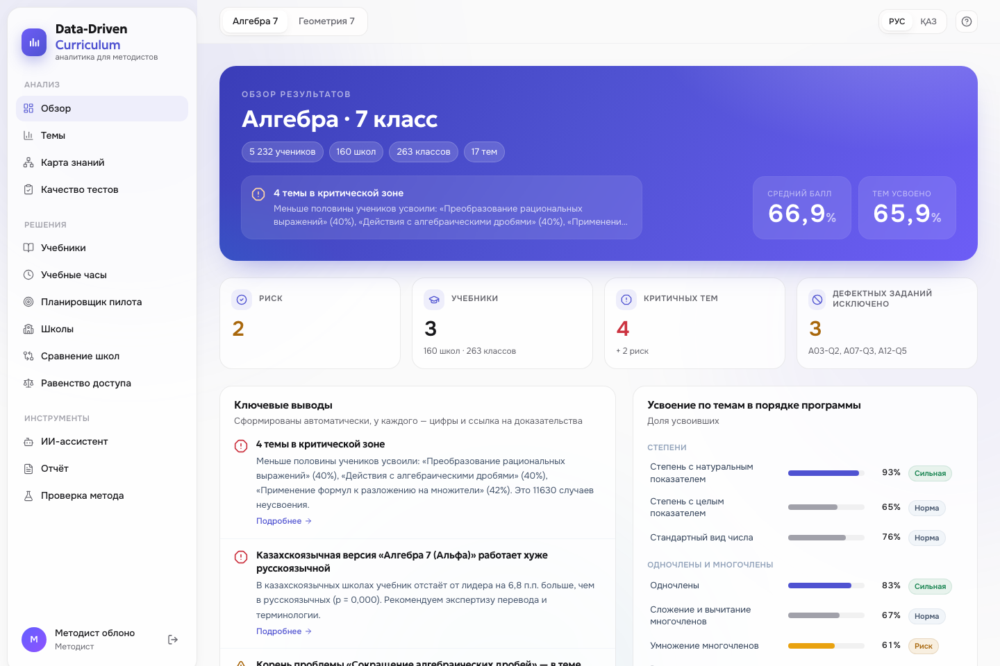
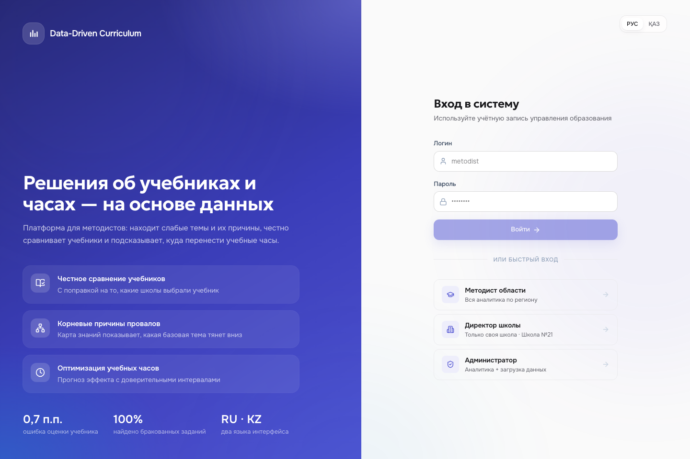
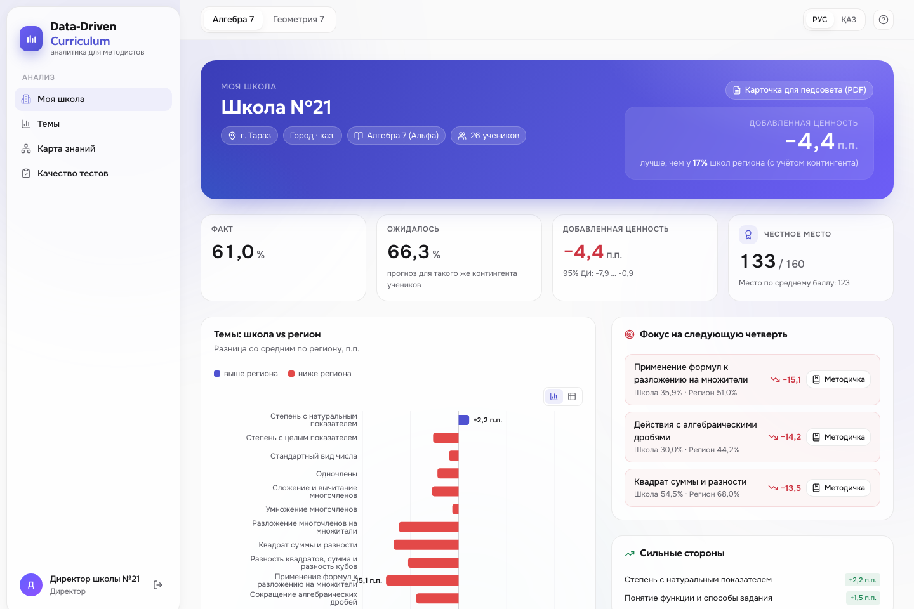
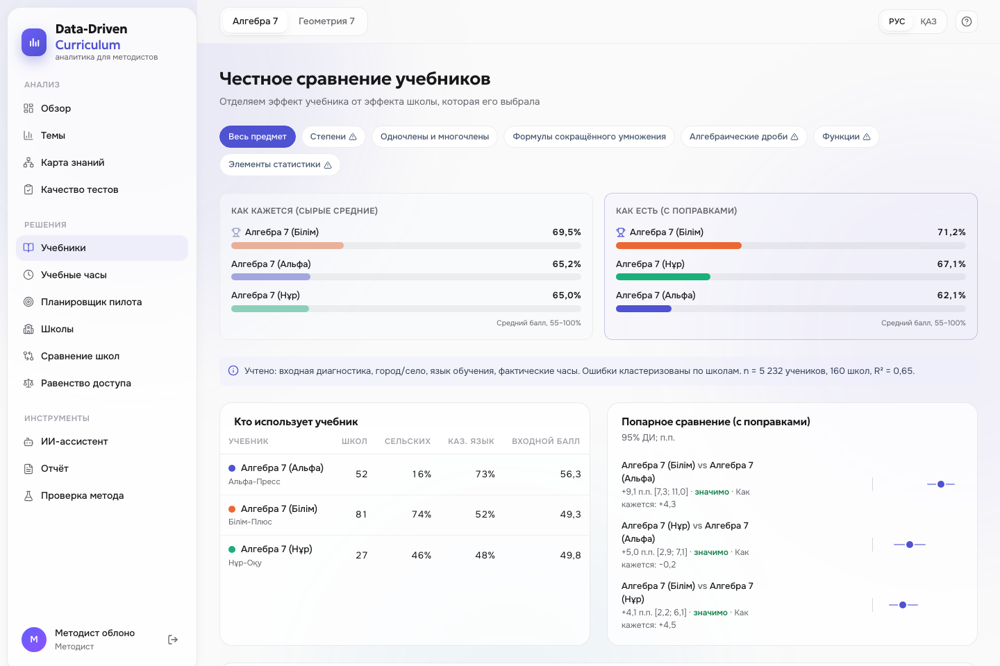
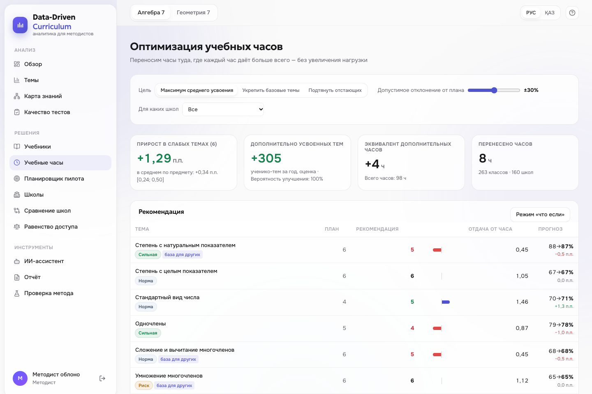
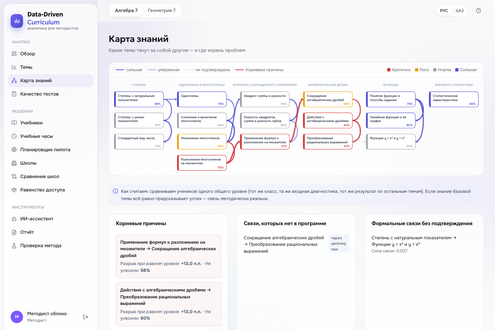
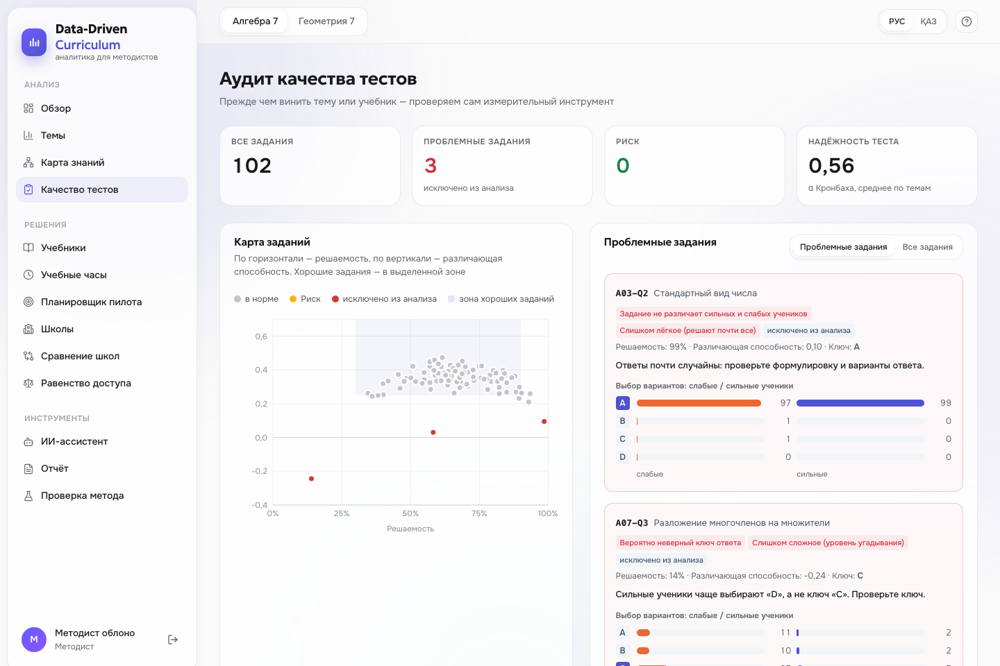
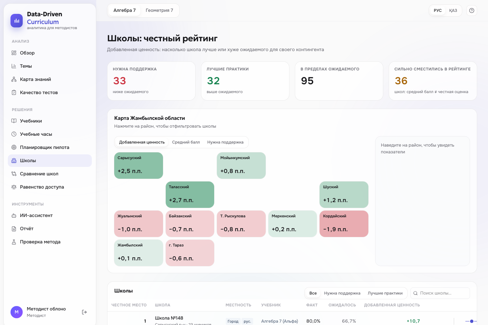
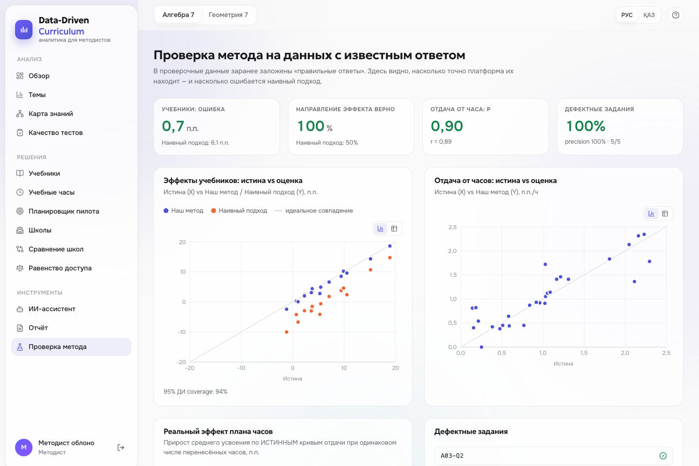

# Data-Driven Curriculum

**EdTech-платформа для методистов: решения об учебниках и учебных часах на основе измеримых результатов, а не интуиции.**

Платформа анализирует результаты тестирования школьников по темам программы, находит сложные разделы и их корневые причины, **честно** сравнивает учебники (с поправкой на то, какие школы их выбрали) и рекомендует, куда перенести учебные часы — с прогнозом эффекта и доверительными интервалами. Интерфейс на русском и казахском.

> Кейс №1 «Data-Driven Curriculum» · Zhambyl Hub Hackathon 2026 · Қорғау сценарийі қазақша: [docs/PITCH_KZ.md](docs/PITCH_KZ.md)



---

## Что делает платформа — по пунктам кейса

| Требование кейса | Что сделано | Где в интерфейсе |
|---|---|---|
| Анализировать результаты по отдельным темам | Усвоение каждой темы с 95% доверительными интервалами, срезы по городу/селу, языку обучения, учебнику; распределение учеников; разброс между школами | «Темы», «Обзор» |
| Выявлять сложные для усвоения разделы | Статус темы (критично / риск / норма), **карта знаний** с поиском корневых причин: «тема X проваливается, потому что не усвоена базовая тема Y» | «Карта знаний», «Темы» |
| Сравнивать эффективность учебников | Регрессия с поправкой на входной уровень, тип школы, язык и часы; кластерные ошибки по школам; детектор **парадокса Симпсона**; сравнение по разделам и темам; «для каких школ какой учебник» | «Учебники» |
| Сравнивать эффективность учебников — «до и после» | Если школы сменили учебник, метод «разность разностей» по результатам за 2 года показывает реальный эффект смены (проверено на известном ответе) | «Учебники» → «До и после» |
| Рекомендации по распределению часов | Кривые убывающей отдачи по каждой теме из естественных отклонений классов от плана, эмпирический Байес, оптимизатор с ограничениями, бутстрэп-интервалы, режим «что если» | «Учебные часы» |

## Чем мы отличаемся

**Новое:** карта районов области · «до/после» смены учебника · планировщик пилота (сколько школ нужно, чтобы доказать эффект) · ученики в зоне риска (прогноз провала до начала темы, AUC 0,80 на незнакомых школах) · методичка по слабой теме.

1. **Честное сравнение учебников вместо сравнения средних.** Учебник выбирает школа, а сильные городские школы выбирают иначе, чем сельские. Наивное сравнение средних баллов сравнивает *школы*, а не *книги*. Мы показываем обе картины рядом и предупреждаем, когда наивный вывод ошибочен (парадокс Симпсона).
2. **Метод проверен на данных с известным ответом.** В демо-данные заранее заложены «правильные ответы» (какой учебник лучше и насколько, где часы дают отдачу, какие задания бракованные). Страница «Проверка метода» показывает, что платформа их находит:
   - ошибка оценки эффекта учебника **0,7 п.п.** против **6,1 п.п.** у наивного сравнения (по 5 независимым выборкам: медиана 0,7, среднее 1,2, худший случай 2,8 — против 6,9 у наивного);
   - 95% доверительные интервалы покрывают истину в **94%** случаев — как и должны;
   - направление эффекта верно в **100%** случаев (наивно — **50%**, как монетка);
   - найдены **5 из 5** дефектных заданий, ложных срабатываний — **0**;
   - корреляция оценённой и истинной отдачи от часов **ρ = 0,90**; план часов даёт тот же эффект, что идеальный план, знающий истину;
   - проблема перевода учебника найдена там, где она заложена, и не найдена там, где её нет.
3. **Сначала проверяем сам тест.** Аудит заданий (различающая способность, анализ дистракторов) находит задания с неверным ключом и случайными ответами и исключает их — иначе «сложная тема» может оказаться просто плохим вопросом.
4. **Не все слабые темы лечатся часами.** Если тема проваливается из-за непонятой базовой темы, дополнительные часы на неё почти не помогают — платформа это видит и направляет ресурс в корень проблемы.
5. **Казахстанский контекст.** Язык обучения как фактор: платформа обнаруживает, что казахскоязычная версия учебника работает хуже русскоязычной (сигнал на экспертизу перевода). Город/село, районы Жамбылской области, интерфейс и отчёты на **казахском** и русском.
6. **Честный рейтинг школ.** Добавленная ценность: школа сравнивается не со всеми, а с ожиданием для её контингента. Маленькие школы не попадают в лидеры или аутсайдеры случайно (эмпирический Байес).
7. **Неопределённость всегда на виду.** Каждая оценка — с доверительным интервалом и пометкой «значимо / не значимо». Если данных мало — так и написано.
8. **Ключевые выводы формируются автоматически** — с цифрами, на двух языках и со ссылкой на доказательства.
9. **ИИ-ассистент, который не выдумывает.** Отвечает на вопросы методиста только по посчитанным данным (любая OpenAI-совместимая модель или Claude); без ключа работает офлайн по автоматическим выводам.
10. **Роли.** Методист видит регион, директор — только свою школу (личный кабинет), администратор загружает данные.
11. **Готово к работе с реальными данными.** Загрузка ZIP / Excel / CSV с проверкой структуры и понятными ошибками, шаблон для заполнения, отчёт для печати / PDF и выгрузка всех рекомендаций в **Excel**.

## Роли и вход

| Роль | Что видит | Демо-доступ |
|---|---|---|
| Методист области | всю аналитику по региону | `metodist` / `demo2026` |
| Директор школы | только свою школу: сравнение с регионом, темы-приоритеты, рекомендации по часам для своего учебника | `director` / `demo2026` |
| Администратор | всё + загрузка данных | `admin` / `admin2026` |

Пароли хранятся в виде scrypt-хешей, сессия — подписанный токен с истечением срока. Права проверяются на сервере: директор не может открыть чужую школу или рейтинг школ даже напрямую через API.

Ссылки для мгновенного входа на демо: `/?demo=metodist`, `/?demo=director`, `/?demo=admin` (язык — `&lang=kz`).

| Вход | Кабинет директора |
|---|---|
|  |  |

## Скриншоты

| Учебники: «как кажется» vs «как есть» | Оптимизация часов |
|---|---|
|  |  |
| **Карта знаний и корневые причины** | **Аудит качества тестов** |
|  |  |
| **Честный рейтинг школ** | **Проверка метода на известном ответе** |
|  |  |

## Методология (кратко)

Подробно — в [docs/METHODOLOGY.md](docs/METHODOLOGY.md).

- **Усвоение темы** — доля верных ответов ученика по заданиям темы; «усвоил» — ≥ 60%. ДИ учитывают кластеризацию учеников по школам.
- **Аудит заданий** — классическая теория тестов: решаемость, различающая способность (корреляция с результатом по остальному предмету), α Кронбаха, ответы слабой и сильной трети учеников по каждому варианту. Неверный ключ = отрицательная различающая способность + сильные ученики выбирают другой вариант.
- **Карта знаний** — частная корреляция результатов по паре тем при фиксированном общем уровне (класс, входная диагностика, результат по остальным темам с полиномиальными членами), за вычетом фонового уровня для несвязанных тем.
- **Учебники** — МНК с кластерно-устойчивыми ошибками по школам и взаимодействиями «учебник × язык / местность / входной уровень»; эффект учебника — **стандартизированный** (g-computation): прогноз для всех учеников региона с каждым учебником; рекомендации по профилю школы.
- **Часы** — по каждой теме `усвоение класса ~ ln(часы) + контроль`, эмпирический Байес с априорным средним, зависящим от уровня усвоения темы, жадная оптимальная аллокация при фиксированном объёме часов и ограничении ±30% от плана, бутстрэп по школам.
- **Школы** — добавленная ценность = среднее «факт − прогноз» по ученикам школы со сжатием к нулю для маленьких школ.

## Архитектура

```
frontend/  React + TypeScript + Vite + Tailwind + Recharts   (12 экранов, RU/KZ)
   │  REST /api/*
backend/   FastAPI
   ├── app/data/        генератор демо-данных с «правильными ответами», загрузка и проверка данных
   ├── app/analytics/   items · topics · prerequisites · textbooks · hours · schools · insights · validation
   ├── app/report.py    структурированный отчёт RU/KZ
   ├── app/ai.py        ИИ-ассистент (Claude) + офлайн-режим
   └── tests/           тесты: аналитика должна находить заложенную истину
```

Один контейнер: FastAPI раздаёт и API, и собранный фронтенд.

## Запуск

**Быстрый старт (локально):**

```bash
./dev.sh          # API на :8000, интерфейс на http://localhost:5173
```

**Docker:**

```bash
docker build -t ddc . && docker run -p 8000:8000 ddc      # http://localhost:8000
```

**Вручную:**

```bash
cd backend && python3 -m venv .venv && .venv/bin/pip install -r requirements.txt
.venv/bin/uvicorn app.main:app --port 8000
cd ../frontend && npm install && npm run build            # после сборки интерфейс доступен на :8000
```

ИИ-ассистент подключается через `backend/.env` (см. `backend/.env.example`): любой OpenAI-совместимый API (`XCIRO_API_KEY`, `XCIRO_BASE_URL`, `XCIRO_MODEL`) или Claude (`ANTHROPIC_API_KEY`). Без ключа работает офлайн-режим. Для продакшена задайте `DDC_SECRET` — секрет подписи токенов.

**Тесты:** `cd backend && .venv/bin/python -m pytest -q`

## Формат данных

Загрузка — ZIP с CSV, Excel-книга (лист на таблицу) или отдельные CSV. Шаблон скачивается на странице «Данные».

| Таблица | Обязательные поля | Источник в реальности |
|---|---|---|
| `subjects` | subject_id, name | программа |
| `topics` | topic_id, subject_id, section, name, planned_hours (+ prerequisites через `;`) | ГОСО / типовая программа |
| `textbooks` | textbook_id, subject_id, title | перечень учебников |
| `schools` | school_id, name (+ district, locality, language) | НОБД |
| `students` | student_id, school_id (+ baseline_score) | входная диагностика |
| `classes` | class_id, school_id, subject_id, textbook_id | школа |
| `hours` | class_id, topic_id, hours | электронный журнал |
| `items` | item_id, topic_id (+ correct_option) | банк заданий |
| `responses` | student_id, class_id, item_id, answer **или** correct | результаты тестирования |

Демо-данные: 160 школ Жамбылской области, 5 232 ученика, алгебра (17 тем) и геометрия 7 класса (11 тем), 879 тыс. ответов, плюс итоги школ за прошлый год (часть школ сменила учебник). Необязательная таблица `history` (school_id, subject_id, year, textbook_id, mean_pct) включает анализ «до/после». Названия школ и издательств вымышлены.

## API

`/api/overview` · `/api/topics` · `/api/topics/{id}` · `/api/graph` · `/api/textbooks` · `/api/hours` · `POST /api/hours/whatif` · `/api/quality` · `/api/schools` · `/api/equity` · `/api/insights` · `/api/validation` · `/api/report` · `/api/export.xlsx` · `POST /api/data/upload` · `POST /api/data/reset` · `/api/data/template.zip` · `POST /api/ai/ask`

Интерактивная документация — `/docs`.

## Ограничения и развитие

- Данные наблюдательные: неучтённые факторы (квалификация учителя, репетиторы) могут влиять на оценки. Рекомендации стоит подтверждать пилотом на части школ — платформа подскажет, где эффект ожидается сильнее всего.
- Следующие шаги: интеграция с Kundelik и результатами МОДО/БЖБ/ТЖБ, динамика по годам (эффект смены учебника «до/после»), A/B-пилоты перераспределения часов, роль директора школы.
